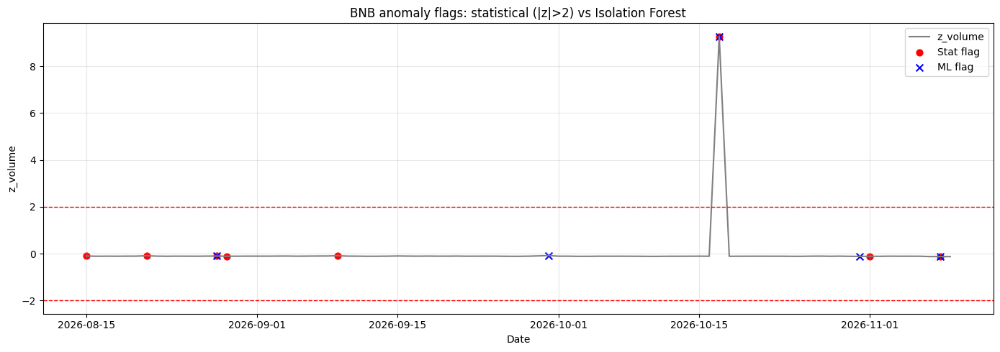
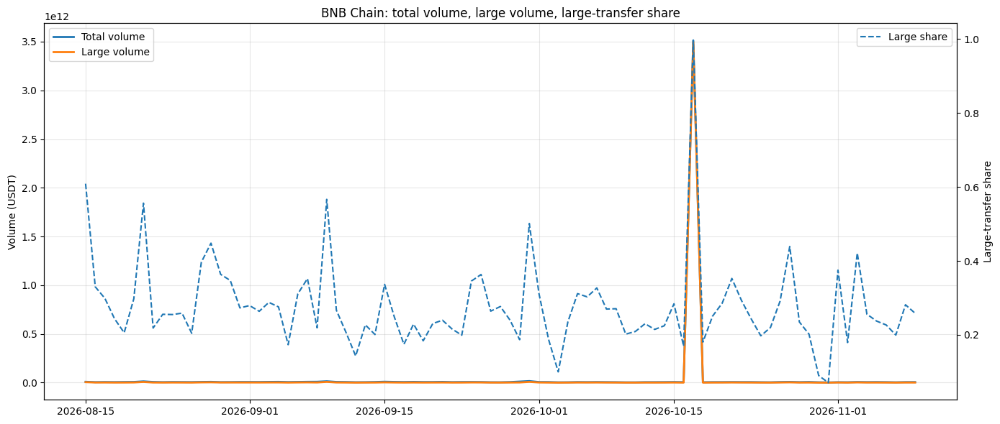
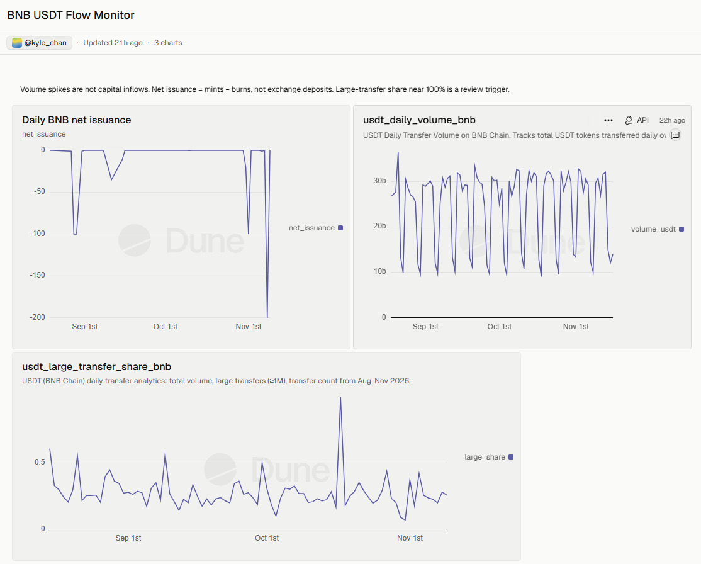

# BNB USDT Flow Intelligence
On-chain monitoring note for USDT on BNB Chain, with Ethereum and Tron as comparison chains.

**Window:** 15 Aug 2026 – 9 Nov 2026  
**Stack:** DuneSQL, Python (pandas, matplotlib, scikit-learn)

---

## 🎯 Goal
Separate three things that are often mixed together:
1. Transfer volume (how much USDT moved)
2. Net issuance (how much USDT was minted or burned)
3. Large-transfer share and holder concentration (how lumpy activity and balances are)

The priority chain is BNB Chain.

---

## 📊 Methodology Matrix

| Step | What was measured | What it is not |
| :--- | :--- | :--- |
| **Volume** | Daily USDT transfer volume by chain | Economic activity or exchange deposits |
| **Net issuance** | Mints minus burns (zero-address transfers) | Exchange net inflow |
| **Velocity** | Daily volume ÷ chain USDT supply (DefiLlama snapshot, 10 Nov 2026; BSC = BNB Chain) | A live supply series |
| **Large-transfer share** | Share of daily BNB volume in transfers ≥ 1,000,000 USDT | Named whale trades |
| **Holders** | Top 10 / top 100 BNB USDT balances from transfer netting | Labeled exchange wallets |
| **Detection** | `\|z-score\| > 2` and Isolation Forest on BNB daily features | A production alert system |

---

## 🔍 Key Findings
1. Mid-October BNB transfer volume spiked because of repeated internal transfers (looping), not because USDT supply increased.
2. Over this window, the large supply increase was a single Tron mint of about 3 billion USDT around 21 Aug. BNB and Ethereum net issuance stayed near zero on that scale.
3. On normal BNB days, about 20–40% of USDT volume is in transfers of at least 1 million USDT. On the mid-October spike day that share was about 100%.
4. About 24% of BNB USDT supply sits in the top 10 addresses and about 40% in the top 100. Addresses are unlabeled and likely include exchanges, bridges, and contracts.
5. A simple statistical rule and Isolation Forest both flag mid-October. They disagree on quieter days. The transparent rule is the one an operations team should act on.

---

## 📈 Key Visualizations

### 1. Multi-Chain Daily Transfer Volume
*Shows multi-chain macro ingestion, highlighting BNB Chain's volume surge in mid-October compared to Ethereum and Tron.*

### 2. Machine Learning Anomaly Detection
*Comparison between traditional statistical z-score flags (`\|z\| > 2`) and unsupervised `Isolation Forest` machine learning anomaly detection on BNB daily features.*

### 3. BNB Chain Whale Activity & Large-Transfer Share
*Tracking total daily volume against large-volume and large-transfer share percentages ($\ge 1\text{M}$ USDT threshold).*

---

## 🌐 Dune Analytics Dashboard & SQL Architecture (Hosting Methods)

### Dashboard External Link
You can view the dashboard hosted on Dune Analytics here: **[bnb-usdt-flow-intelligence/figures/dune_dashboard_preview.png]**

*Dashboard UI Preview:*
> 

### Method B: Transparent SQL Query Directory
To inspect the production-ready DuneSQL queries powering this intelligence framework, view the version-controlled script files located in the repository's `sql/` directory:

* [`sql/daily_bnb_net_issuance.sql`](bnb-usdt-flow-intelligence/sql/Daily BNB net issuance) — Tracks daily BNB Chain USDT mints, burns, and net issuance flows.
* [`sql/bnb_large_transfer_share.sql`](bnb-usdt-flow-intelligence/sql/usdt_large_transfer_share_bnb) — Computes the daily volume share of whale and large-ticket transfers ($\ge 1\text{M}$ USDT threshold).
* [`sql/usdt_daily_volume.sql`](bnb-usdt-flow-intelligence/sql/usdt_daily_volume_bnb) — Extracts multi-chain USDT transfer volumes and transaction counts for comparative analysis.

---

## ⚙️ Operational Recommendations
- Do not alert on raw BNB transfer volume alone.
- Review a BNB day when volume is extreme and either large-transfer share is far outside the 20–40% band or net issuance moves.
- Treat top-holder concentration as a custody check. Label exchange and contract wallets before calling a balance a whale.

---

## ⚠️ Limitations
- Fixed window only. Not a live feed.
- Net issuance is not exchange flow.
- Supply is one snapshot, held constant.
- Holder balances are reconstructed from transfers and are approximate.
- Anomaly detection was run on BNB only, with no labeled incident list.

---

## 📂 How to Read This Repo
1. `summary/one_page_summary.md` — findings and recommendations
2. `notebooks/usdt_flow_intelligence.ipynb` — full analysis
3. `figures/` — charts and visual assets used in the summary and README
4. `sql/` — raw production-ready SQL queries (Method B)
5. `data/sample/` — cleaned inputs behind the charts

---

## 🗄️ Data Sources
- **Dune:** `erc20_bnb`, `erc20_ethereum`, `erc20_tron` transfer events
- **DefiLlama:** USDT-by-chain snapshot (BNB Chain listed as BSC): [https://defillama.com/stablecoin/tether](https://defillama.com/stablecoin/tether)
