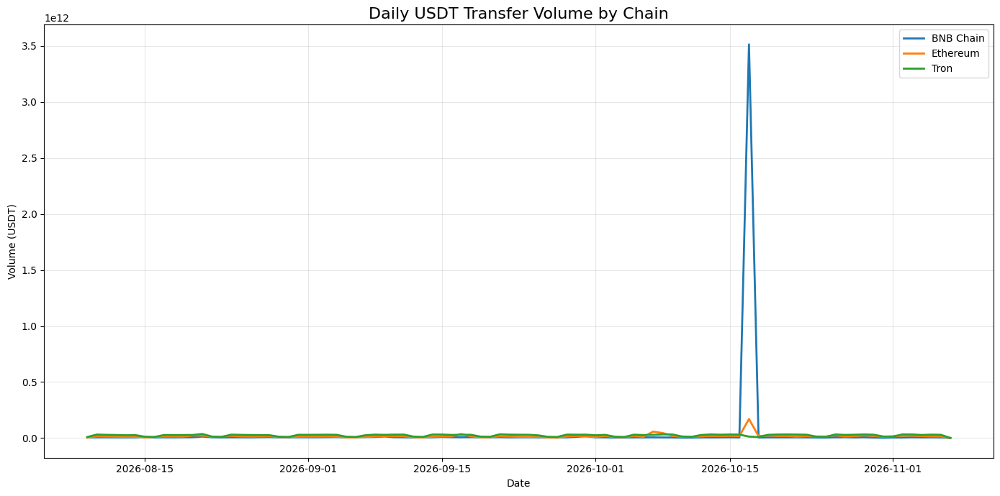

# BNB USDT Flow Intelligence
On-chain monitoring note for USDT on BNB Chain, with Ethereum and Tron as comparison chains.

**Window:** 15 Aug 2026 – 9 Nov 2026  
**Stack:** DuneSQL, Python (pandas, matplotlib, scikit-learn)

---

## 🎯 Goal
Separate three things that are often mixed together:
1. Transfer volume (how much USDT moved)
2. Net issuance (how much USDT was minted or burned)
3. Large-transfer share and holder concentration (how lumpy activity and balances are)

The priority chain is BNB Chain.

---

## 📊 Methodology Matrix

| Step | What was measured | What it is not |
| :--- | :--- | :--- |
| **Volume** | Daily USDT transfer volume by chain | Economic activity or exchange deposits |
| **Net issuance** | Mints minus burns (zero-address transfers) | Exchange net inflow |
| **Velocity** | Daily volume ÷ chain USDT supply (DefiLlama snapshot, 10 Nov 2026; BSC = BNB Chain) | A live supply series |
| **Large-transfer share** | Share of daily BNB volume in transfers ≥ 1,000,000 USDT | Named whale trades |
| **Holders** | Top 10 / top 100 BNB USDT balances from transfer netting | Labeled exchange wallets |
| **Detection** | `\|z-score\| > 2` and Isolation Forest on BNB daily features | A production alert system |

---

## 🔍 Key Findings
1. Mid-October BNB transfer volume spiked because of repeated internal transfers (looping), not because USDT supply increased.
2. Over this window, the large supply increase was a single Tron mint of about 3 billion USDT around 21 Aug. BNB and Ethereum net issuance stayed near zero on that scale.
3. On normal BNB days, about 20–40% of USDT volume is in transfers of at least 1 million USDT. On the mid-October spike day that share was about 100%.
4. About 24% of BNB USDT supply sits in the top 10 addresses and about 40% in the top 100. Addresses are unlabeled and likely include exchanges, bridges, and contracts.
5. A simple statistical rule and Isolation Forest both flag mid-October. They disagree on quieter days. The transparent rule is the one an operations team should act on.

---

## 📈 Key Visualizations

### 1. Multi-Chain Daily Transfer Volume
*Shows multi-chain macro ingestion, highlighting BNB Chain's volume surge in mid-October compared to Ethereum and Tron.*

### 2. Machine Learning Anomaly Detection
*Comparison between traditional statistical z-score flags (`\|z\| > 2`) and unsupervised `Isolation Forest` machine learning anomaly detection on BNB daily features.*

### 3. BNB Chain Whale Activity & Large-Transfer Share
*Tracking total daily volume against large-volume and large-transfer share percentages ($\ge 1\text{M}$ USDT threshold).*

---

## 🌐 Dune Analytics Dashboard & SQL Architecture (Hosting Methods)

### Dashboard External Link
You can view the dashboard hosted on Dune Analytics here: **[bnb-usdt-flow-intelligence/figures/dune_dashboard_preview.png]**

*Dashboard UI Preview:*
> 

### Method B: Transparent SQL Query Directory
To inspect the production-ready DuneSQL queries powering this intelligence framework, view the version-controlled script files located in the repository's `sql/` directory:

* [`sql/Daily BNB net issuance.sql`](bnb-usdt-flow-intelligence/sql/Daily BNB net issuance) — Tracks daily BNB Chain USDT mints, burns, and net issuance flows.
* [`sql/bnb_large_transfer_share.sql`](bnb-usdt-flow-intelligence/sql/usdt_large_transfer_share_bnb) — Computes the daily volume share of whale and large-ticket transfers ($\ge 1\text{M}$ USDT threshold).
* [`sql/usdt_daily_volume.sql`](bnb-usdt-flow-intelligence/sql/usdt_daily_volume_bnb) — Extracts multi-chain USDT transfer volumes and transaction counts for comparative analysis.

---

## ⚙️ Operational Recommendations
1. **Do not alert on raw BNB transfer volume alone.** A volume spike with no matching mint, burn, or labeled exchange deposit is a candidate for looping or wash activity. Require a second check before treating it as market stress or new capital.

2. **Watch two BNB metrics together each day.**
   - Share of volume in transfers of at least 1 million USDT (normal band here: about 20–40%; a reading near 100% is a review trigger).
   - Net USDT minted minus burned (should stay near zero unless Tether actually issues or redeems on that chain).
   Flag a day only when volume is extreme **and** one of these two also moves.

3. **Treat top-holder concentration as a custody check, not a trading signal.** Review the top 10 and top 100 BNB USDT addresses on a set schedule. Label exchange, bridge, and contract wallets before calling any balance “whale accumulation.”

4. **Use the simple rule as the daily screen; use the model only as a second opinion.** Both methods caught mid-October. Operations should act on the transparent rule. Use the model to suggest extra days worth a look, not to replace the rule.

---

## BNB Chain point (for a Binance-style reader)

The only material anomaly in this sample is on **BNB Chain**, and it is a **transfer-quality** problem, not a **supply** problem. USDT supply on BNB did not jump when reported volume exploded. A monitoring stack that ranks chains by raw transfer volume would have misread mid-October as BNB “thriving.” A stack that also checks issuance and large-transfer share would have classified it as artificial activity.

## Limitations and assumptions

- Dates covered are 15 August 2026 through 9 November 2026 only. Patterns may not hold outside this window.
- “Net flow” here means USDT minted minus USDT burned on that chain. It is **not** deposits to or withdrawals from exchanges.
- Missing mint/burn days were treated as zero. Tron’s result is one large mint, not a steady trend.
- Chain supply is one snapshot (10 November 2026, DefiLlama; BNB Chain is listed there as BSC), held constant. It does not follow daily supply changes.
- Holder shares come from adding up historical transfers, not from a dedicated balance database. Shares are approximate. Addresses are not labeled.
- “Large transfer” means at least 1 million USDT. A different cutoff would change the 20–40% band.
- The statistical rule and the model were run on BNB Chain only, on a short daily sample, with no official list of true incidents. Agreement is not proof.
- This is a monitoring note for research and operations. It is not a trading recommendation.
---

## 🗄️ Data Sources
- **Dune:** `erc20_bnb`, `erc20_ethereum`, `erc20_tron` transfer events
- **DefiLlama:** USDT-by-chain snapshot (BNB Chain listed as BSC): [https://defillama.com/stablecoin/tether](https://defillama.com/stablecoin/tether)
