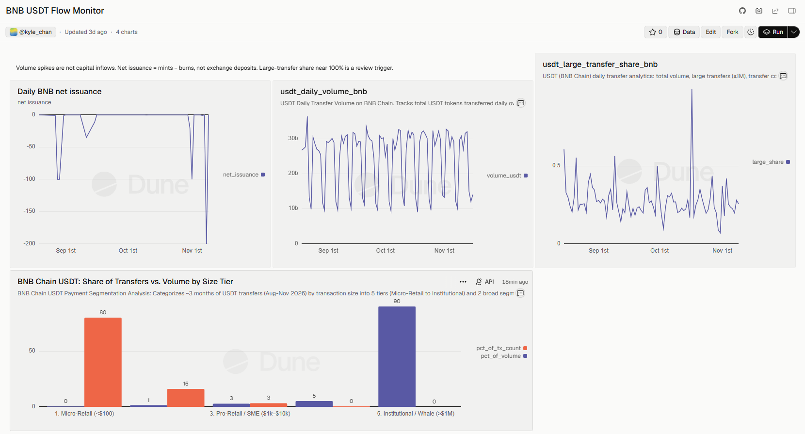

# BNB Chain USDT Payment & Liquidity Structure: Retail (To-C) vs. B2B Settlement
**An On-Chain Empirical Study of Stablecoin Payment Behavior, Capital Velocity, and Volume Anomalies**

**Window:** 15 Aug 2026 – 9 Nov 2026  
**Stack:** DuneSQL, Python (`pandas`, `matplotlib`, `scikit-learn`)  
**Scope:** BNB Chain (Primary), Ethereum & Tron (Benchmarks)

---

## 🧭 Research Topic & Core Thesis

**Research Question:** *How is USDT actually used on BNB Chain—is it primarily a high-frequency retail micro-payment rail (To-C), or a large-ticket B2B and institutional settlement network?*

Raw transfer volume on public blockchains often misleads analysts into thinking retail payment adoption is surging when volume spikes are actually driven by institutional looping or treasury reshuffling. To isolate true user payment behavior on BNB Chain, this study separates four metrics that are frequently conflated:
1. **Payment Tier Structure (To-C vs. B2B):** Segmenting every USDT transfer by dollar size (`<$10k` Retail/To-C vs. `≥$10k` B2B/Institutional) to compare transaction frequency against capital dominance.
2. **Transfer Volume:** How much USDT moved daily across BNB Chain, Ethereum, and Tron.
3. **Net Issuance:** How much USDT was actually minted or burned on-chain.
4. **Large-Transfer Share & Holder Concentration:** How lumpy daily activity and address balances are.

---

## 📊 Executive Research Findings: Payment Size Segmentation

Across **1,291,938,984** total USDT transfer events totaling **$4,062,782,156,713.09 (`~$4.06T`)** in volume over the observation window, BNB Chain exhibits a sharp structural bifurcation between user activity and capital flow:

| Payment Tier | Segment | Transfer Count | % of Transfers | Total Volume (USDT) | % of Volume |
| :--- | :--- | :---: | :---: | :---: | :---: |
| **1. Micro-Retail (<$100)** | To-C / Retail (<$10k) | 1,033,942,347 | 80.03% | $13,828,908,396.61 | 0.34% |
| **2. Standard Retail ($100–$1k)** | To-C / Retail (<$10k) | 208,315,584 | 16.12% | $59,775,931,253.49 | 1.47% |
| **3. Pro-Retail / SME ($1k–$10k)** | To-C / Retail (<$10k) | 42,551,451 | 3.29% | $115,376,337,783.23 | 2.84% |
| **4. B2B / Commercial ($10k–$1M)** | B2B / Institutional (≥$10k) | 5,873,351 | 0.45% | $214,260,041,015.26 | 5.27% |
| **5. Institutional / Whale (≥$1M)** | B2B / Institutional (≥$10k) | 1,256,251 | 0.10% | $3,659,540,938,264.50 | 90.07% |
| **Total** | **All Tiers** | **1,291,938,984** | **100.00%** *(99.99% rounded)* | **$4,062,782,156,713.09** | **100.00%** *(99.99% rounded)* |

### Core Takeaways
* **Retail / To-C Dominance in Frequency (`<$10k`):** Retail-sized transfers account for **1,284,809,382** transfers (**99.45%** of all transfer events), with micro-payments under `$100` alone representing **80.03%** of network transfer activity—confirming BNB Chain's role as a high-throughput retail payment rail. However, all `<$10k` tiers combined account for only **$188.98B (4.65%)** of dollar volume.
* **B2B / Institutional Dominance in Capital (`≥$10k`):** Commercial and institutional transfers represent just **7,129,602** transfers (**0.55%** of count) yet drive **$3.87T (95.35%)** of total USDT volume—with institutional transfers of **`≥$1M`** alone accounting for **90.07%** (`$3.66T`) of cumulative volume.
* **Mid-October Volume Distortion:** Mid-October BNB transfer volume spiked because of repeated internal large-ticket transfers (looping), not because USDT supply increased. On normal BNB days, roughly **20–40%** of daily USDT volume comes from transfers $\ge \$1\text{M}$; on the mid-October spike day, that share reached nearly **100%**.
* **Cross-Chain Net Issuance Contrast:** Over this window, the only material supply expansion occurred on Tron via a single mint of roughly **3 billion USDT** around 21 Aug. BNB Chain and Ethereum net issuance remained near zero on that scale.
* **Holder Concentration & Anomaly Detection:** Roughly **24%** of BNB USDT supply sits in the top 10 addresses and **~40%** in the top 100 (unlabeled wallets likely spanning exchanges, bridges, and smart contracts). Both a transparent statistical rule (`|z-score| > 2`) and an unsupervised `Isolation Forest` model flag the mid-October spike, though they diverge on quieter days.

---

## 📊 Methodology Matrix

| Step | What was measured | What it is not |
| :--- | :--- | :--- |
| **Payment Size Tiers** | ERC-20 `Transfer` event logs (`erc20_bnb.evt_Transfer`) bucketed by USD value (`<$10k` To-C vs. `≥$10k` B2B) | Unique transaction hashes (`evt_tx_hash`) or KYC-verified user identities |
| **Volume** | Daily USDT transfer volume by chain | Organic economic activity or exchange deposits |
| **Net Issuance** | Mints minus burns (zero-address transfers) | Exchange net inflow |
| **Velocity** | Daily volume ÷ chain USDT supply (DefiLlama snapshot, 10 Nov 2026; BSC = BNB Chain) | A live daily supply time series |
| **Large-Transfer Share** | Share of daily BNB volume in transfers ≥ 1,000,000 USDT | Named whale trades |
| **Holders** | Top 10 / top 100 BNB USDT balances from transfer netting | Labeled exchange wallets |
| **Detection** | `\|z-score\| > 2` and `Isolation Forest` on BNB daily features | A production alert system |

---

## 📈 Key Visualizations

### 1. BNB Chain USDT Payment Structure: Share of Transfers vs. Volume by Size Tier
*Demonstrates the structural divergence between high-frequency retail micro-payments (`<$100` at 80.03% of transfers) and capital-dominant institutional settlement (`≥$1M` at 90.07% of volume).*

### 2. Multi-Chain Daily Transfer Volume
*Shows multi-chain macro ingestion, highlighting BNB Chain's volume surge in mid-October compared to Ethereum and Tron.*

### 3. BNB Chain Whale Activity & Large-Transfer Share
*Tracks total daily volume against large-volume and large-transfer share percentages ($\ge 1\text{M}$ USDT threshold).*

### 4. Machine Learning Anomaly Detection
*Comparison between traditional statistical z-score flags (`\|z\| > 2`) and unsupervised `Isolation Forest` machine learning anomaly detection on BNB daily features.*

---

## 🌐 Dune Analytics Dashboard & SQL Architecture

### Dashboard Preview
*Dune Analytics Dashboard UI Snapshot:*
> 

### Transparent SQL Query & Dataset Directory
To inspect the production-ready DuneSQL queries and aggregated output powering this research framework, view the version-controlled files in `sql/` and `data/`:

* [`sql/bnb_payment_size_tiers.sql`](sql/bnb_payment_size_tiers.sql) — Segments BNB Chain USDT transfers into five behavioral tiers (`<$100` to `≥$1M`) comparing To-C retail frequency against B2B/institutional capital volume.
* [`sql/Daily BNB net issuance.sql`](<sql/Daily BNB net issuance.sql>) — Tracks daily BNB Chain USDT mints, burns, and net issuance flows.
* [`sql/usdt_large_transfer_share_bnb.sql`](sql/usdt_large_transfer_share_bnb.sql) — Computes the daily volume share of whale and large-ticket transfers ($\ge 1\text{M}$ USDT threshold).
* [`sql/usdt_daily_volume_bnb.sql`](sql/usdt_daily_volume_bnb.sql) — Extracts multi-chain USDT transfer volumes and event counts for comparative analysis.
* [`data/BNB_Chain_USDT_Share_of_Transfers_vs_Volume_by_Size_Tier.csv`](data/BNB_Chain_USDT_Share_of_Transfers_vs_Volume_by_Size_Tier.csv) — Aggregated payment tier dataset exported from Dune Analytics (`tx_count` reflects `COUNT(*)` transfer events).

---

## ⚙️ Operational Recommendations

1. **Separate retail payment growth from institutional volume spikes.** A surge in raw BNB USDT volume accompanied by `≥$1M` transfer share approaching 100% and zero net minting reflects institutional looping—not organic To-C retail adoption.
2. **Do not alert on raw BNB transfer volume alone.** Require a second confirmation check (either a surge in `≥$1M` large-transfer share above the 20–40% baseline band or an on-chain net issuance change) before classifying a volume spike as market stress or fresh capital inflow.
3. **Treat top-holder concentration as a custody check, not a trading signal.** Review the top 10 and top 100 BNB USDT addresses on a scheduled cadence, and label exchange, bridge, and smart contract wallets before interpreting balance shifts as whale accumulation.
4. **Use the transparent statistical rule as the primary daily screen; use ML as a secondary triage tool.** Both `|z-score| > 2` and `Isolation Forest` caught the mid-October distortion. Operations teams should act on the interpretable statistical rule and use `Isolation Forest` to surface secondary days for manual review.

---

## 💡 Strategic Takeaway (BNB Chain Ecosystem Perspective)

BNB Chain serves two distinct roles simultaneously: it is an ultra-active **retail micro-payment rail** (over 1.28 billion `<$10k` transfers in under three months), yet its headline dollar volume is heavily governed by **large-ticket institutional settlement**. A monitoring stack that ranks chains by raw transfer volume alone would have misread mid-October as a retail adoption boom, whereas pairing payment-size tiering with net issuance and large-transfer share accurately isolates artificial looping from real supply growth.

---

## ⚠️ Limitations and Assumptions

* **Observation Window:** Dates covered are 15 August 2026 through 9 November 2026 only; seasonal or structural patterns may differ outside this window.
* **Behavioral Proxy Assumption (`<$10k` vs. `≥$10k`):** Segmenting To-C retail from B2B/institutional flows by transfer dollar size is an empirical heuristic; high-net-worth individuals may execute `≥$10k` transfers and businesses may execute automated `<$10k` payouts.
* **Transfer Events vs. Transaction Hashes:** Tier counts (`tx_count` in the underlying CSV) reflect ERC-20 `Transfer` event logs (`COUNT(*)` on `erc20_bnb.evt_Transfer`) rather than distinct transaction hashes (`COUNT(DISTINCT evt_tx_hash)`), meaning multi-hop smart contract transactions emit multiple transfer events.
* **Net Issuance Definition:** "Net flow" measures on-chain USDT minted minus burned (zero-address events), not centralized exchange deposits or withdrawals. Missing mint/burn days are treated as zero.
* **Static Supply Snapshot:** Chain supply is anchored to a single DefiLlama snapshot (10 November 2026; listed as BSC) rather than a daily historical supply series.
* **Unlabeled Addresses & Model Scope:** Top-holder shares are derived from cumulative transfer netting without entity labels. Statistical and `Isolation Forest` detection models were evaluated on a short daily BNB Chain sample without ground-truth incident labels and are intended for research and operational triage—not trading advice.
